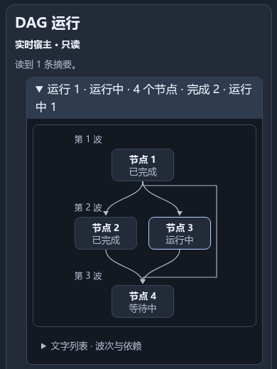

# OmO Web


**在终端发起，在浏览器继续。**

OmO Web 是 [OmO Native](https://github.com/code-yeongyu/oh-my-openagent) 的本机工作台。打开浏览器就能在项目间切换、处理 Agent 提问和工具审批，或接着本机 CLI 的会话工作。模型、凭据和工具执行都由本机 OmO 管理。

[快速开始](#快速开始) · [工作区与会话](#工作区与会话) · [模型与审批](#模型与审批) · [工具台账](#工具台账) · [运行详情](#运行详情) · [命令](#命令) · [CLI 交接](#cli-交接) · [访问与安全](#访问与安全) · [发行与开发](#发行与开发)

## 快速开始

安装 [Bun 1.3+](https://bun.sh/docs/installation) 和 OmO Native，在 `omo` 里配好模型。用有仓库访问权限的 GitHub 账户克隆源码。

```sh
git clone \
  https://github.com/NekoCCN/OmO-Web.git
cd OmO-Web
bun install --frozen-lockfile
OMO_WEB_WORKSPACES="$HOME/projects/demo" \
  bun start
```

把示例路径换成已有的项目目录，再打开 [http://127.0.0.1:4317](http://127.0.0.1:4317) 或终端打印的地址。`bun start` 先构建再启动；已经构建过就用 `bun run serve`。

## 工作区与会话

在左栏切换工作区，Web 会话和 CLI 列表随项目切换。点「浏览工作区」查看已授权目录的文件名和子目录，也可以确认授权一个新的项目目录。

新会话使用当前工作目录。已有会话可以搜索、重命名、归档和恢复；长对话先显示最近 80 条，往前翻时再加载历史。生成过程中可以追问、停止回合或管理输入队列。发送消息时可附带 PNG、JPEG、GIF 或 WebP 图片，每条最多 4 张、每张约 2 MiB。

## 模型与审批

在输入框旁切换当前会话的模型、调整思考档位或开启快速模式。上下文快用满时，可以手动压缩，也可以启用自动压缩。

工具审批默认「询问」。选择「Auto」后，OmO 按原生规则判断是否放行；选择「无审批」需要确认。确认、选择和结构化问题可以在对话里直接答，私密输入留在本机 CLI。

## 工具台账


连续成功的文件探查可以折成一组。展开后按原顺序查看每次读取、搜索的参数和回执；正在运行、失败或等你处理的事项单独显示。Todo 卡片记录这次提交了哪些任务，状态行显示当前待办。命令和脚本也有各自的详情，展开后再看输入和输出。

## 运行详情



打开「会话侧栏」，可以查看上下文用量、缓存命中率、会话树、子代理和长期记忆计数。DAG 视图按波次排列节点，箭头标出依赖；展开下方的文字列表也能逐条查看。子代理和 DAG 面板用于查看状态。扩展、MCP 和命令清单在「能力」页签里。

## 命令

在输入框键入 `/` 或 `$`，用方向键选择命令、提示模板或技能。按 Enter、Tab 或点击候选会把它填入草稿，再按「执行命令」运行。

- `/todo`、`/tasks`、`/dag` 打开本会话的待办、子代理和依赖图。
- `/model` 切换模型，`/thinking` 调整思考档，`/compact` 压缩上下文。
- `/fork` 从指定消息前创建分支，`/clone` 将当前会话复制为新会话。
- `/help` 查看命令，`/hotkeys` 查看键盘操作。

## CLI 交接

Web 和 CLI 使用同一个 OmO profile 时，可以接着同一份日志工作。侧栏点开一条本机 CLI 会话先看历史，选「在 Web 继续」接着聊。会话还在另一个进程里打开时，先在那边退出。

想随时看 CLI 对话的进展，打开「跟随 CLI」。「CLI 实时」则可以连接已开启原生控制的会话，在浏览器发普通消息、停止当前回合。这个 CLI 会话的工具审批和私密交互仍在终端处理。

要回到终端，在会话页点「会话管理 → 转到 CLI」释放会话，把显示的本机命令复制到终端运行，同一个会话继续。

## 访问与安全

默认只监听本机回环，不要求密码。常用变量：

| 变量 | 说明 |
| --- | --- |
| `OMO_WEB_WORKSPACES` | 可用项目目录，默认启动目录 |
| `OMO_WEB_PORT` | 监听端口，默认 `4317` |
| `OMO_WEB_PASSWORD_FILE` | 密码文件，`0600` 独立文件，用户名固定为 `omo` |
| `OMO_WEB_DATA` | Web 会话索引与私有日志，默认 `~/.omo-web` |
| `OMO_WEB_CLI_AGENT_DIR` | 与 CLI 共用的 OmO profile 目录 |
| `OMO_WEB_BIN` | Native CLI 可执行文件，默认 `omo` |

跨设备访问时，同时配置密码和 HTTPS，建议通过私有网络或 VPN 连接。这个服务为单人使用设计，工具权限由本机 OmO 处理。参见[完整环境变量](docs/usage.md#环境变量)和[远程访问设置](docs/usage.md#密码与远程访问)。

## 发行与开发

从源码运行，或者构建一份可直接解压启动的发行包：

```sh
bun run release:pack
```

产物为 `dist/omo-web-$VERSION.tar.gz` 和同名 `.sha256`。把两个文件放在同一目录，校验后解压，用 Bun 启动包里的 `dist/server.js`。发行包带齐项目依赖；启动前装好 Bun 和 OmO Native。升级时保留 Web 数据目录和原来的 OmO profile。

```sh
bun run check     # TypeScript
bun test          # 回归测试
bun run build     # 构建浏览器资源
bun run serve     # 跳过重构建直接启动
```

[使用详解](docs/usage.md) · [安装、升级和发版](docs/install-release.md) · [0.1.0 发行说明](docs/releases/0.1.0.md) · [包管理器选型](docs/distribution.md)

[Web API](docs/web-api.md) · [CLI 功能对照](docs/parity/local-cli-web-matrix.md) · [界面约定](DESIGN.md)
