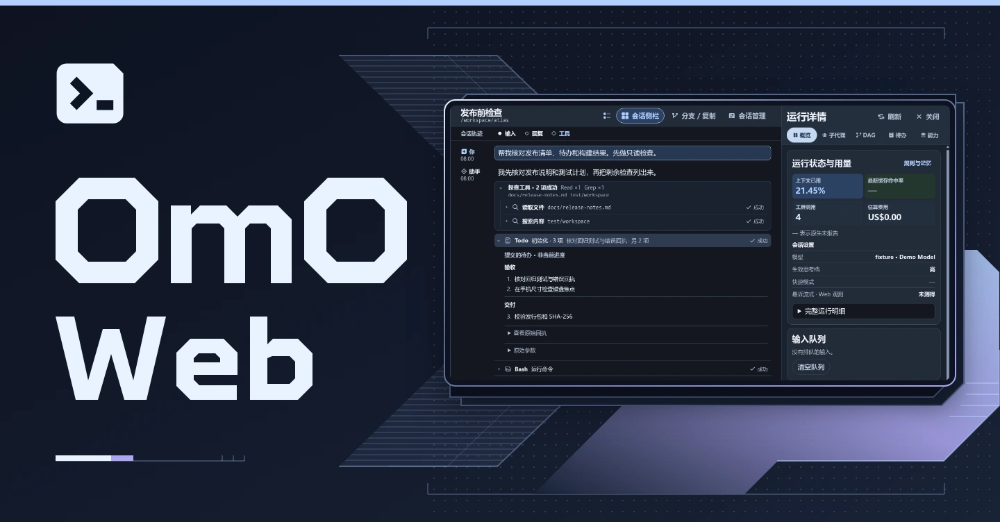
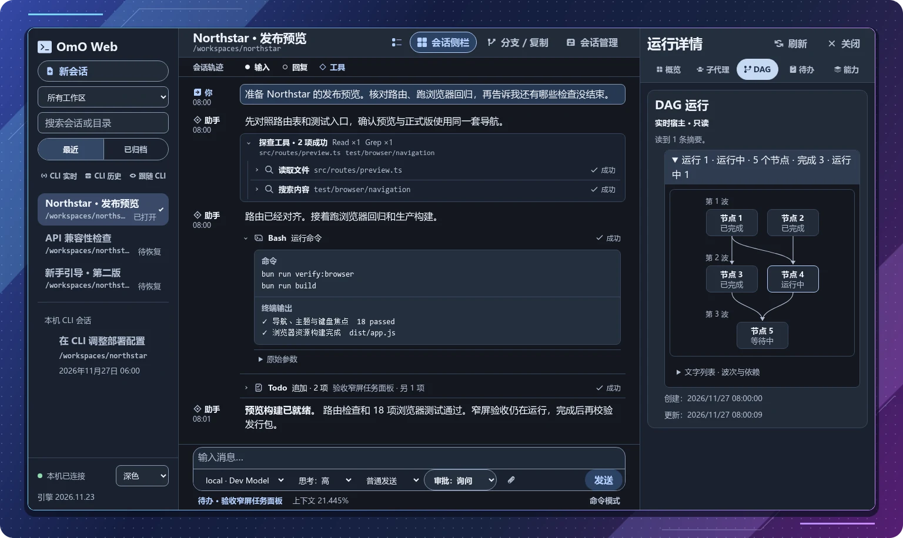

# OmO Web



**在终端发起，在浏览器继续。**

OmO Web 把 [OmO Native](https://github.com/code-yeongyu/oh-my-openagent) 的会话、工具和运行状态放进一个浏览器工作台。切换项目、继续 CLI 里的对话、处理审批，或者边写代码边盯着多个任务的进度。模型、凭据和工具执行仍由本机 OmO 管理。

[快速开始](#快速开始) · [工作台一览](#工作台一览) · [日常用法](#日常用法) · [快捷命令](#快捷命令) · [配置](#访问与安全) · [发行与开发](#发行与开发)

## 快速开始

安装 [Bun 1.3+](https://bun.sh/docs/installation) 和 OmO Native，在 `omo` 里配好模型。可以直接下载 [GitHub 发行包](https://github.com/NekoCCN/OmO-Web/releases/latest)，也可以克隆源码：

```sh
git clone \
  https://github.com/NekoCCN/OmO-Web.git
cd OmO-Web
bun install --frozen-lockfile
OMO_WEB_WORKSPACES="$HOME/projects/demo" \
  bun start
```

把示例路径换成已有的项目目录，再打开 [http://127.0.0.1:4317](http://127.0.0.1:4317) 或终端打印的地址。`bun start` 先构建再启动；已经构建过就用 `bun run serve`。

## 工作台一览



左栏找项目和会话，中间跟进对话与工具输出，右栏看运行详情。侧栏按需打开；手机上从顶部按钮呼出，给对话留出空间。界面支持跟随系统、浅色和深色三种主题设置。

## 日常用法

### 管理项目和会话

左栏默认列出不同目录的 Web 和 CLI 会话；点会话继续工作，不必先切项目。目录筛选只缩小列表，不会切走当前对话。创建会话时单独选工作目录；也可以打开「目录」浏览已授权位置，或输入绝对路径临时加一个目录。常用目录放进启动配置，下次打开还能选。界面语言可在左栏底部切换为 English 或简体中文。

会话可以搜索、重命名、标记完成、归档和恢复。回看旧讨论时，往上加载更早的消息；想试另一条思路，用「分支 / 复制」从选中的用户消息前开分支，或保留当前上下文创建副本。Web 会话、CLI 历史和已连接的 CLI 都有这个入口。

### 发消息、调整模型和处理审批

回复边生成边显示。运行中想到要改方向，选「引导当前轮」；下一件事可以选「本轮后发送」。在右栏查看或清空队列，也可以用输入区的「停止」结束当前回合。需要给 Agent 看界面或报错截图时，每条消息可附带最多 4 张 PNG、JPEG、GIF 或 WebP 图片，每张约 2 MiB。

模型、思考档位和快速模式都在输入框旁操作。选项来自原生 OmO，切换只影响当前会话。长任务可以看着上下文用量决定何时手动压缩，也可以启用自动压缩。

工具审批默认「询问」。在浏览器里完成确认、选择、文本回复和结构化问答；「Auto」按原生规则判断是否放行，「无审批」需要显式确认。私密输入在本机 CLI 处理。

### 看执行过程

- **会话轨迹**：一键跳到最近的输入、回复或工具调用。有待答事项时，从同一栏跳过去处理。
- **工具台账**：展开文件探查组，按原顺序查看读取、搜索等回执。文件编辑、终端命令、代码执行、网页读取和子代理有各自的摘要与详情，原参数按需展开。
- **待办与子代理**：状态行显示当前待办，工具卡保留每次变更；右栏能查看本会话的待办、子代理和 DAG。DAG 按波次显示节点，箭头标出依赖。
- **会话侧栏**：集中查看上下文、缓存命中率、token 与费用、会话树、项目规则和记忆信息。「能力」页签列出命令、扩展与 MCP。

### 在 CLI 和 Web 之间继续

Web 和 CLI 使用同一个 OmO profile 时，可以接着同一份会话日志工作：

1. **终端转 Web**：从左栏打开本机 CLI 会话预览，选「在 Web 继续」。如果原终端仍打开该会话，先从那里退出。
2. **Web 转终端**：当前回合和待答事项处理完后，选「会话管理 → 转到 CLI」，在终端运行页面给出的命令。

只想看进展时，用「跟随 CLI」查看当前对话。如果要从浏览器向一个正在运行的终端发普通消息或停止回合，用「CLI 实时」连接已开启原生控制的会话；该会话的工具审批和私密交互留在终端。

## 快捷命令

在输入框键入 `/` 或 `$`，用方向键选命令、提示模板或技能。按 Enter、Tab 或点选候选来填入草稿，再执行。

| 想做什么 | 命令 |
| --- | --- |
| 新开、找回或整理会话 | `/new`、`/resume`、`/rename` |
| 看会话信息或分支 | `/session`、`/tree` |
| 从当前进度另开一条线 | `/fork`、`/clone` |
| 调整模型或释放上下文 | `/model`、`/thinking`、`/compact` |
| 查看待办、子代理或依赖 | `/todo`、`/tasks`、`/dag` |
| 找命令和键盘用法 | `/help`、`/hotkeys` |

## 访问与安全

默认只监听本机回环，不要求密码。常用变量：

| 变量 | 说明 |
| --- | --- |
| `OMO_WEB_WORKSPACES` | 可用项目目录，默认启动目录 |
| `OMO_WEB_PORT` | 监听端口，默认 `4317` |
| `OMO_WEB_PASSWORD_FILE` | 密码文件（POSIX `0600` / Windows 私有 ACL），用户名 `omo` |
| `OMO_WEB_ALLOW_UNAUTHENTICATED` | 显式接受全接口无密码模式；仍要求 HTTPS |
| `OMO_WEB_DATA` | Web 会话索引与私有日志，默认 `~/.omo-web` |
| `OMO_WEB_CLI_AGENT_DIR` | 与 CLI 共用的 OmO profile 目录 |
| `OMO_WEB_BIN` | Native CLI 可执行文件，默认 `omo` |

在 Linux 上，用冒号隔开多个工作目录，启动后会话就能在同一个工作台里并列显示：

```sh
dirs="$HOME/code/api:$HOME/code/ui"
OMO_WEB_WORKSPACES="$dirs" bun start
```

在外地访问时，用 `0.0.0.0` 监听并配置 HTTPS；建议通过 VPN 连接并设置密码。受限私网可以显式选择无密码，启动器和网页会提示风险。见 [Linux 与 Windows 的远程配置](docs/usage.md#密码与远程访问)。

## 常见问题

- **浏览器提示 OmO 未连接**：在启动 Web 的终端运行 `omo --version`。如果命令不在 `PATH`，把 `OMO_WEB_BIN` 指向实际的可执行文件。
- **列表里没有原来的 CLI 会话**：先选「所有目录」，再确认会话目录已授权，且 Web 和 CLI 使用同一个 OmO profile。
- **找不到模型或登录失败**：先在 `omo` 里配置模型并登录。配置和凭据继续由 OmO 使用。
- **关掉页面后，任务还在跑吗？** 刷新或关闭页面不会停止生成。要结束当前回合，用「停止」；关掉 Web 服务会结束这个 Web 引擎上的运行任务。

## 发行与开发

从源码运行，或者构建一份可直接解压启动的发行包：

```sh
bun run release:pack
```

产物为 `dist/omo-web-$VERSION.tar.gz` 和同名 `.sha256`。把两个文件放在同一目录，校验后解压，用 Bun 启动包里的 `dist/server.js`。发行包带齐项目依赖；启动前装好 Bun 和 OmO Native。升级时保留 Web 数据目录和原来的 OmO profile。

```sh
bun run check     # TypeScript
bun test          # 回归测试
bun run build     # 构建浏览器资源
bun run serve     # 跳过重构建直接启动
```

[使用详解](docs/usage.md) · [安装、升级和发版](docs/install-release.md) · [0.1.0 发行说明](docs/releases/0.1.0.md) · [包管理器选型](docs/distribution.md)

[Web API](docs/web-api.md) · [CLI 功能对照](docs/parity/local-cli-web-matrix.md) · [界面约定](DESIGN.md)

## 许可证

OmO Web 采用 [MIT 许可证](LICENSE)。发行包同时保留所含第三方组件的许可文本。
