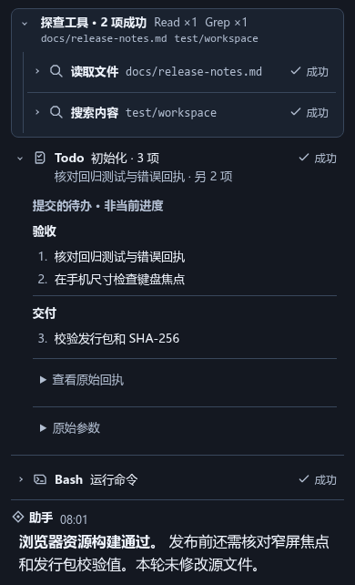

# OmO Web


**在终端发起，在浏览器继续。**

[OmO Native](https://github.com/code-yeongyu/oh-my-openagent) 的本机会话工作台：在浏览器里继续对话、处理审批、读懂工具调用。模型、凭据和执行依然由本机 OmO 管理，浏览器不接触模型密钥。

[快速开始](#快速开始) · [工具台账](#工具台账) · [只读 DAG](#只读-dag) · [访问与安全](#访问与安全) · [发行与开发](#发行与开发)

## 快速开始

先安装 [Bun](https://bun.sh/docs/installation) 和 OmO Native，并在 Native CLI 配好模型。源码仓库为私有，克隆前请确认 Git 已配置有访问权限的凭据。

```sh
git clone \
  https://github.com/NekoCCN/OmO-Web.git
cd OmO-Web
bun install --frozen-lockfile
OMO_WEB_WORKSPACES="$HOME/projects/demo" \
  bun start
```

把示例路径换成已有的项目目录，再打开 **[http://127.0.0.1:4317](http://127.0.0.1:4317)** 或终端打印的地址。`bun start` 会先构建；已有构建时用 `bun run serve` 跳过重构建。

实测基线：**Linux · Bun 1.4.5 · OmO Native 5.1.83（Senpi 2026.11.23）**。macOS 尚未实机复验；Windows 仅验证文件浏览与目录授权，不代表完整 CLI 互操作。

---

## 工具台账



*Chrome 实拍 · 合成会话：展开探查组后，可以逐条查看原调用及回执。*

- **继续工作。** 管理多个工作区和会话，接收流式回复、处理 Agent 提问与审批，按需停止或排队。同一 profile 下可只读预览本机 CLI 历史，再显式“在 Web 继续”打开同一份日志；持有中的会话不会被强行接管。
- **看清工具做了什么。** 连续且已确认成功的探查可合成为一条摘要，展开仍逐条显示参数与回执；运行中、失败和待答各自独立显示。Todo 区分提交的待办与当前进度，侧栏另有上下文、用量、会话树和只读子代理。
- **CLI 实时与跟随是两个入口。** 实时连接已开启原生控制的本机 CLI，可发送普通消息、可停止已核验的当前回合；跟随只读查看唯一可核验的对话，不发送、不接管。工具审批与私密交互仍由 CLI 前的人处理。

## 只读 DAG


*Chrome 实拍 · 合成会话：4 节点、3 波次的只读 DAG 拓扑。*

- **按波次读依赖。** 运行详情展示 DAG 波次与依赖、会话树、长期记忆计数和完整用量；任务与 DAG 页面没有写操作，不展示自由文本标题、私密字段或原生 ID。
- **读不到才看快照。** 运行详情在打开、刷新或页面重新可见时读取宿主；只有宿主明确不支持读取时，才使用标为非实时的磁盘快照。
- **Web 不替代完整 TUI。** 直接查看命令不发送给模型，原生持久设置、调度与全局管理留在本机。逐项差异见 [CLI 对齐矩阵](docs/parity/local-cli-web-matrix.md)。

---

## 访问与安全

默认只监听本机回环、不要求密码。跨设备访问必须同时配置密码和 HTTPS；这是单操作者的控制面，不是多用户服务，不建议直挂互联网。工具权限由 OmO 判断，**审批不是沙箱**。详见[环境变量](docs/usage.md#环境变量)和[密码与远程访问](docs/usage.md#密码与远程访问)。

## 发行与开发

`bun run release:pack` 在本地生成 `.tar.gz` 和 SHA-256 校验文件；解压后不需重装项目依赖，仍需 Bun 与 OmO Native。发行资产尚未上传时用源码启动；目前没有包管理器安装命令。

- [安装、升级和维护者发版](docs/install-release.md) · [包管理器选型](docs/distribution.md)
- [使用详解](docs/usage.md) · [Web API](docs/web-api.md) · [界面约定](DESIGN.md) · [0.1.0 发行说明](docs/releases/0.1.0.md)
- [开发与验证](docs/usage.md#开发与验证) · [CLI 差异与覆盖](docs/parity/local-cli-web-matrix.md)
