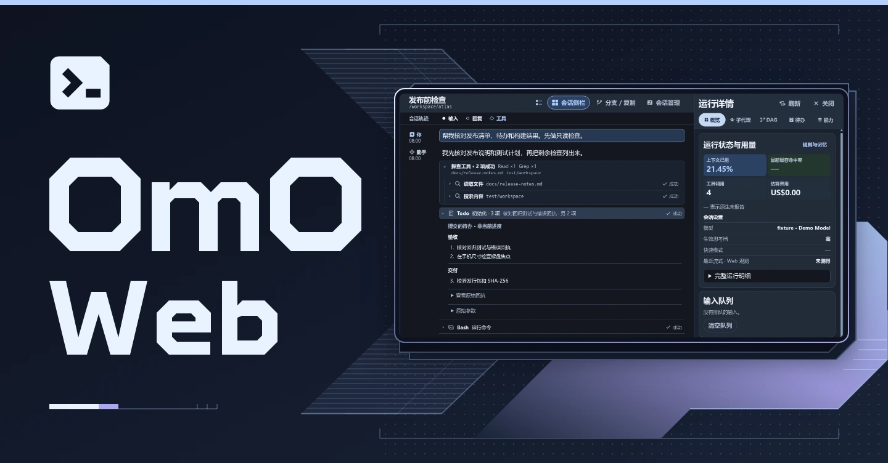
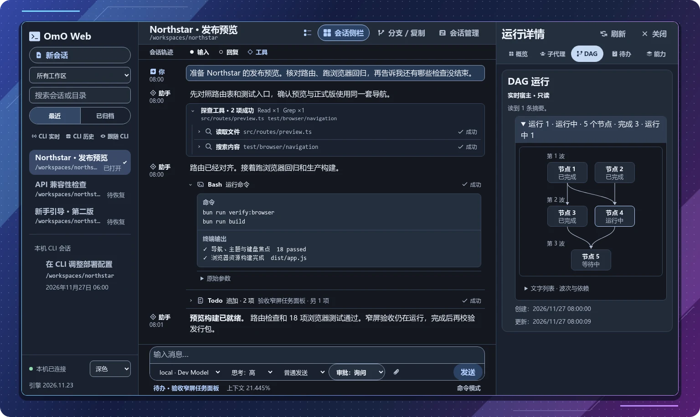

# OmO Web

[English](README.md) · 简体中文



**在终端发起，在浏览器继续。**

OmO Web 是 [OmO Native](https://github.com/code-yeongyu/oh-my-openagent) 的本机浏览器工作台。不同项目的会话可以并列；你可以继续 CLI 对话、回应审批和提问、查看工具输出与任务依赖。模型、凭据和工具执行仍由本机 OmO 管理。

[安装](#安装) · [工作台一览](#工作台一览) · [日常用法](#日常用法) · [快捷命令](#快捷命令) · [外地访问](#外地访问) · [构建与开发](#构建与开发)

## 安装

安装 [Bun 1.3+](https://bun.sh/docs/installation) 和 [OmO Native](https://github.com/code-yeongyu/oh-my-openagent)，先用 `omo` 配好模型。使用 npm 安装终端启动器还需 Node.js 18+。

```sh
npm install -g omo-web
cd /path/to/your/project
omo-web
```

上面的命令安装公开 [npm](https://www.npmjs.com/package/omo-web) 的 `latest`。若不走 npm registry，可从 [GitHub Release](https://github.com/NekoCCN/OmO-Web/releases/tag/v0.1.4) 下载 `0.1.4` 的 `.tgz` 和校验文件，校验后运行 `npm install -g ./omo-web-0.1.4.tgz`。下载需要仓库访问权限。

在交互终端运行 `omo-web`，用方向键和回车选择工作目录、进入「访问设置」或启动服务。打开它打印的地址，默认是 [http://127.0.0.1:4317](http://127.0.0.1:4317)。运行中要改设置，先停止服务；访问设置会保留，工作目录编辑只对本次 TUI 会话有效。脚本用 `omo-web serve` 直接启动。

有仓库访问权限时，也可以从 [GitHub Release](https://github.com/NekoCCN/OmO-Web/releases/tag/v0.1.4) 下载 Bun 运行包，或从源码运行：

```sh
git clone https://github.com/NekoCCN/OmO-Web.git
cd OmO-Web
bun install --frozen-lockfile
OMO_WEB_WORKSPACES="$HOME/projects/demo" bun start
```

把示例路径换成实际项目。`bun start` 先构建再启动；已经构建过就运行 `bun run serve`。Windows PowerShell 设置目录的方式见[远程与环境配置](docs/usage.md#环境变量)。

## 工作台一览



左栏找会话，中间跟进对话与工具，右栏看运行详情。手机上从顶部呼出侧栏。浏览器界面可在左栏底部切换中英文和浅深主题，终端启动器跟随系统语言。

## 日常用法

### 管理会话

左栏默认列出各目录的 Web 和 CLI 会话。目录筛选只缩小列表，不会切走当前对话或清空草稿。新会话单独选执行目录。打开「目录」可浏览已授权位置，也可输入绝对路径临时添加目录。

会话可以搜索、重命名、标记完成、归档和恢复。Web 会话中可点击「加载更早消息」翻页，长文本只在主动展开时分块读取。想试另一条思路，用「分支 / 复制」从一条用户消息前开分支，或保留当前上下文创建副本。

### 发消息和处理审批

普通回复实时显示；运行中可选「引导当前轮」或「本轮后发送」。右栏可以查看或清空队列。输入区支持停止、附件、模型、思考档和快速模式。

工具审批默认「询问」。浏览器可回复确认、选择和结构化问题；私密输入仍回到本机 CLI。工具卡按类型显示摘要：Todo 列变更，Agent 卡可读提示词，原始参数和回执按需展开。运行侧栏可看上下文、用量、会话树、待办、子代理和只读 DAG。

### 在浏览器和终端间继续

Web 和 CLI 使用同一 OmO profile 时，可继续同一份会话日志。终端转 Web，先在原终端退出该会话，再从左栏的历史预览选择「在 Web 继续」；Web 转终端，等当前回合和待答事项处理完，从「会话管理」选择「转到 CLI」，运行页面给出的命令。

「跟随 CLI」是只读视图；「CLI 实时」只对支持原生控制的会话开放。Windows 已验证 Web 服务、密码模式和 npm 安装；不要把这当作 CLI 实时接管或逐项终端交互的兼容承诺。

## 快捷命令

在输入框键入 `/` 或 `$`，用方向键选命令、提示模板或技能。回车或 Tab 先填入草稿，再执行。

| 想做什么 | 命令 |
| --- | --- |
| 新开、找回或整理会话 | `/new`、`/resume`、`/rename` |
| 看会话信息、分支或复制 | `/session`、`/tree`、`/fork`、`/clone` |
| 调整模型或释放上下文 | `/model`、`/thinking`、`/compact` |
| 打开当前会话设置 | `/settings`（也可用 `/setting`） |
| 查看待办、子代理或依赖 | `/todo`、`/tasks`、`/dag` |
| 查命令和键盘操作 | `/help`、`/hotkeys` |

## 外地访问

默认只监听本机。在「访问设置」可以改密码、独立开关密码和 HTTPS、生成 SSL 自签证书，并选择仅本机、指定 IPv4 网卡或全部 IPv4（`0.0.0.0`）。生成证书需要 `PATH` 上的 OpenSSL 1.1.1+；请打开启动器显示的 HTTPS 地址，并在访问设备上核验证书。浏览器登录用户名为 `omo`。短密码可保存，会显示提醒；远程访问建议至少 20 字符。

非本机监听必须使用 HTTPS。选网卡不会改防火墙，也不会限制客户端来源，推荐通过 VPN 并设置密码。无密码只适合能限制连接对象的私网：能连接的人可以读会话并操作本机。

用内网穿透或反代终止 HTTPS 时，让 OmO Web 继续监听 `127.0.0.1`，在「访问设置 → 代理入口」或 `OMO_WEB_PROXY_ORIGIN` 中填写对外地址，并按[代理配置说明](docs/usage.md#内网穿透与反向代理)保留 `Host`。

[Linux 和 Windows 的远程配置](docs/usage.md#密码与远程访问) · [环境变量](docs/usage.md#环境变量)

## 构建与开发

```sh
bun run check
bun test
bun run release:pack
bun run npm:pack
```

[使用详解](docs/usage.md) · [安装与升级](docs/install-release.md) · [0.1.4 发行说明](docs/releases/0.1.4.md) · [发行方式](docs/distribution.md) · [Web API](docs/web-api.md) · [CLI 功能对照](docs/parity/local-cli-web-matrix.md)

OmO Web 采用 [MIT 许可证](LICENSE)。构建产物也包含所用第三方组件的许可。
